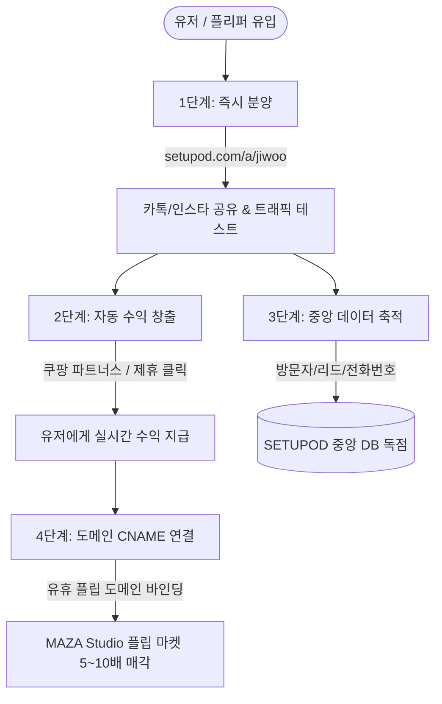

# SETUPOD 2026 비즈니스 마스터 플랜: 디지털 명함 & 도메인 플리퍼 생태계

**문서 버전:** v2.0 (Executive Master Plan)  
**작성일자:** 2026년 10월 12일  
**책임 파트너:** SETUPOD × MAZA Studio × AutoSite  

---

## 1. 비즈니스 코어 철학: "앞문(무자본 분양) ➔ 데이터 & 플립 독점"

> **"돈 벌러 온 플리퍼와 유저들에게 처음에 진입 비용을 받지 않는다.  
> 0원으로 즉시 자기 명함과 도메인에 수익 사이트를 달아주고, 우리는 원천 데이터(리드, 트래픽)와 도메인 플립 매각 수수료를 독점한다."**

---

## 2. 4단계 비즈니스 실행 아키텍처

### 1단계: 진입장벽 제로(0원) 즉시 분양 URL 지원
- **동작 방식:**
  - 유저가 도메인을 사지 않아도 `setupod.com/a/:slug` (예: `setupod.com/a/jiwoo`)로 1초 만에 3D 인터랙티브 명함이 배포됨.
  - Vercel Edge Rewrite 및 Dynamic Card Engine을 통해 별도 서버 없이 무한 확장(Infinite Scaling).

### 2단계: 유저 수익화 모듈 (쿠팡 파트너스 / 제휴 링크 슬롯)
- **동작 방식:**
  - `maker.html`에서 유저가 본인의 쿠팡 파트너스 링크나 제휴 상품 링크를 1줄 입력.
  - 명함 하단에 고품격 글래스모피즘 골드 배너(`affiliateAction`) 자동 렌더링.
  - 명함을 받은 지인/고객이 상품을 구매할 때마다 유저에게 지속적인 수수료가 떨어져 **"유저가 스스로 명함을 적극 전파하게 만드는 강력한 인센티브"** 제공.

### 3단계: 중앙 데이터 독점 (우리의 원천 수익)
- **동작 방식:**
  - 전국의 수천 명의 유저가 각자의 명함을 뿌릴 때마다:
    1. **방문 경로 (Referrer):** 인스타그램, 카카오톡 단톡방, 네이버, 검색 키워드 자동 분석
    2. **고객 리드 (Leads):** 1초 간편 문의/전화번호 + 상담 메모
  - 모든 데이터가 셋업팟의 중앙 Supabase(`leads`, `page_views`)로 100% 통합 수집.
  - **결과:** 우리는 대한민국 1인 기업, 프리랜서, 로컬 비즈니스 실무자들의 B2B DB를 가장 빠르고 저렴하게 독점 확보.

### 4단계: 도메인 플리퍼 CNAME 연동 & MAZA Studio 매각
- **동작 방식:**
  - 유저가 명함 트래픽과 수익을 확인하면, 잠자고 있던 플립 도메인(예: `jiwoo.kr`)을 연결하도록 유도.
  - CNAME(`cname.setupod.com`) 연결 시 화이트라벨링 자동 적용 (셋업팟 로고 숨김, 유저 고유 브랜드 표시).
  - 유저는 *"실제 트래픽과 쿠팡 수익이 나오는 살아있는 턴키 웹사이트"* 상태로 해당 도메인을 **MAZA Studio 도메인 마켓플레이스에 고가(5배~10배)로 출품하여 현금화**.

---

## 3. 기술 구현 현황 (2026-10-12 완료)

| 모듈 | 소스 경로 | 구현 및 배포 상태 |
|---|---|---|
| **중앙 리드 & 분석 엔진** | `setupod/js/supabase.js` | • 인스타/카톡/네이버 출처 파싱 완료 • 모바일/PC 기기 판별 및 메모 필드 추가 |
| **CRM 관리 대시보드** | `setupod/bizcard/dashboard.html` | • 5컬럼 실시간 리드 테이블 바인딩 완료 • 7일 방문자 차트 및 전화 걸기 연동 |
| **즉시 분양 URL 라우팅** | `setupod/vercel.json` `setupod/js/card-renderer.js` | • `/a/:slug` 및 `/c/:slug` 무제한 라우팅 완료 |
| **수익화 슬롯(쿠팡 파트너스)** | `setupod/bizcard/maker.html` `setupod/bizcard/card.html` | • 제휴 링크 입력 섹션 추가 • 골드 글래스 배너 동적 렌더링 완료 |
