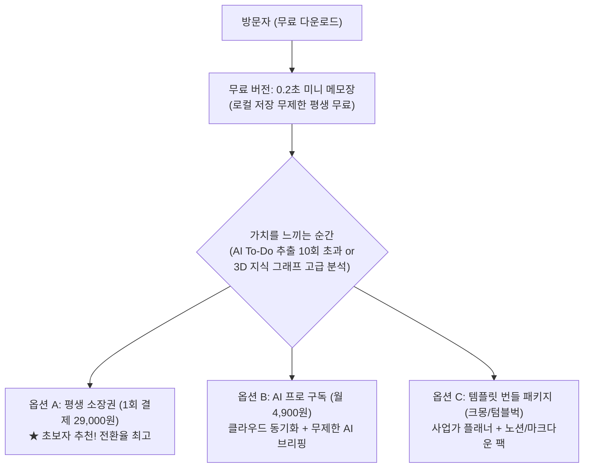
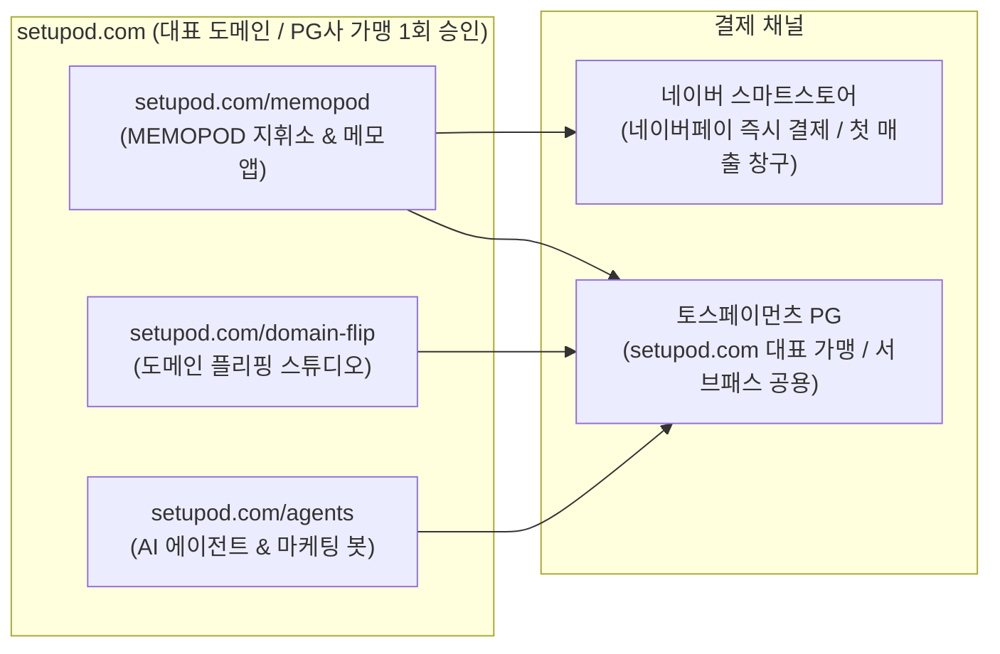

# MEMOPOD 2.0 수익화 및 비즈니스 실전 마스터플랜 & To-Do
> **SETUPOD Business Roadmap · Solopreneur Micro-SaaS Execution Blueprint**  
> 최종 업데이트: 2026년 10월 17일 | 프로젝트: MEMOPOD 2.0 & SETUPOD

---

## 1. 비즈니스 모델 요약 (3대 수익화 축)

1. **평생 소장권 (Lifetime Deal / 1회 결제 29,000원)**:
   - 미니 메모장은 평생 무료 배포로 유저를 모으고,
   - AI To-Do 자동 추출, 3D 지식 그래프, 애플/삼성 메모 동기화, 마크다운 일괄 내보내기를 PRO 기능으로 묶어 1회성 라이선스 판매.
2. **AI 통합 패스 (월 구독 4,900원)**:
   - 개인 API 키 입력 시 무료, 원클릭 편의성을 원하는 사용자 대상 월 구독.
3. **SETUPOD 에셋 번들 (크라우드펀딩 / B2B)**:
   - 2026 사업가 플래너 및 지식 자산화 템플릿과 결합하여 판매.

---

## 2. 결제 & 인프라 구조 (서브패스 통합 모델)

- **대표 도메인 가맹 원칙**: `setupod.com` 도메인 1개로 토스페이먼츠/이니시스 PG 가맹 승인을 받으면, 하위 서브패스(`setupod.com/memopod`, `setupod.com/domain-flip` 등)의 모든 결제를 추가 가맹비 없이 하나의 정산 계좌로 통합 처리할 수 있습니다.
- **스마트스토어 역할**: PG 가맹 심사 기간 동안 또는 네이버페이 유저 타겟으로 오늘 당장 첫 결제를 받는 안전하고 빠른 창구로 활용합니다.

---

## 3. 마케팅 파이프라인 (쓰레드 Threads x 인스타 자동화)

- **보유 자산 연계**:
  - `/Volumes/M/추천 프로젝트/_사업화_보류/ttj_threads_2026` (쓰레드 포스팅 엔진)
  - `/Volumes/M/추천 프로젝트/_사업화_보류/바이럴훅라이트_v0.2.13` (바이럴 카피 생성)
  - `domain-flip-insta` (인스타그램 4:5 카드뉴스 생성 엔진)
- **핵심 타겟**: 2040 직장인, 1인 창업가, 생산성 툴(노션/옵시디언) 헤비 유저, 프리랜서
- **3단계 바이럴 공식**:
  1. **공감 훅**: *"회의 끝나고 적어둔 메모들... 어디 적었는지 못 찾아서 헤매던 분들 계신가요?"*
  2. **솔루션 시연**: 0.2초 만에 단축키로 메모하고 웹 지휘소에서 To-Do 뽑히는 10초 영상
  3. **CTA**: *"무료 버전은 프로필 링크에서 다운로드 받으실 수 있습니다!"*

---

## 4. 실전 실행 To-Do 마스터 리스트 (Action Checklist)

### [Phase 0: 서브패스 배포 및 무결점 실행 엔진 구축] (완료 ✅)
- [x] **0-1. setupod.com/memopod 서브패스 라우팅 정상화**: `vercel.json`의 `/core/memopod.html` 오작동 경로를 `/memopod/index.html` 및 `/memopod/$1`로 전면 수정
- [x] **0-2. setupod/memopod 2.0 자산 배포**:
  - `index.html`: MemoPod 2.0 공식 랜딩페이지 (다운로드 버튼 `/assets/...` 및 웹 대시보드 `./app.html` 연결)
  - `app.html`: AI Web Command Center 지휘소 대시보드
  - `quick.html`: 애플 메모장 스타일 3패널 미니 메모앱
  - `css/` & `js/`
- [x] **0-3. "웹은 연결 안돼" 및 실행 오류 완벽 차단**:
  - `MemoPod` 맥 런처: `nohup` 데몬화 적용, 정상 작동 Python 3 바이너리 사전 검증 로직 추가, 포트 8990 준비 대기 루프 및 서버 미구동 시 `file://` 즉시 폴백
  - `MemoPod.bat` 윈도우 런처: Python 미설치 환경 자동 감지 및 `file://` 무설치 폴백
- [x] **0-4. 인스톨러 최신 패키지 빌드 및 setupod/assets 동기화**:
  - `MemoPod_2.0_Installer.dmg` (0.26 MB)
  - `MemoPod_2.0_Windows_Portable.zip` (0.07 MB)

---

### [Phase 1: 오늘 당장 첫 판매 세팅 (스마트스토어)] (진행 예정)
- [ ] **1. 스마트스토어 상품 등록**
  - 상품명: `[초경량 0.2MB] MemoPod 2.0 PRO 평생 소장권 (맥/윈도우 겸용 AI 지휘소)`
  - 카테고리: `디지털 콘텐츠` ➔ `컴퓨터 소프트웨어` (또는 `기타`)
  - 판매가: 정가 49,000원 ➔ 얼리버드 할인가 **29,000원**
  - 배송 설정: **배송 없음 (직접 발송)**
- [ ] **2. 발송 콘텐츠 패키지 준비**
  - 구매자에게 발송할 텍스트 안내문 작성:
    - 맥용 다운로드 링크 (`https://setupod.com/assets/MemoPod_2.0_Installer.dmg`)
    - 윈도우용 다운로드 링크 (`https://setupod.com/assets/MemoPod_2.0_Windows_Portable.zip`)
    - 웹 지휘소 접속 주소 (`https://setupod.com/memopod/app.html`)
    - 최초 1회 [우클릭 ➔ 열기] 가이드 및 PRO 인증 라이선스 키
- [ ] **3. 네이버 톡톡 자동응답 설정**
  - '결제 완료' 시 구매자 톡톡으로 다운로드 링크 자동 전송 설정
- [ ] **4. 랜딩페이지 구매 링크 연결**
  - `landing.html` 및 `setupod/memopod/index.html`의 [PRO 구매하기] 버튼에 스마트스토어 URL 연결

---

### [Phase 2: 내일~모레 트래픽 및 첫 구매자 확보 (쓰레드 마케팅)]
- [ ] **5. 10초 시연 클립 녹화**
  - 맥북 바탕화면에서 미니 메모장에 툭툭 적고 ➔ 웹 지휘소에서 AI To-Do와 3D 지식 그래프가 번쩍이며 생성되는 10초 화면 녹화
- [ ] **6. 쓰레드(Threads) 계정 프로필 세팅**
  - 프로필 소개: *"생각을 자산으로 만드는 0.2MB 초경량 도구 @setupod"*
  - 프로필 링크: 스마트스토어 또는 `https://setupod.com/memopod` 링크 삽입
- [ ] **7. 쓰레드 1일차 런칭 포스팅 발행**
  - 10초 시연 클립 + 진솔한 개발 스토리 게시
- [ ] **8. 디스콰이엇(Disquiet) & 긱뉴스(GeekNews) 제작기 공유**
  - "노션이 무거워서 직접 만든 0.2MB 미니 메모장 + 지식 그래프" 제작기 공유

---

### [Phase 3: 장기 지속 가능한 사업 인프라 구축 (setupod.com PG)]
- [ ] **9. setupod.com 메인 홈 하단 필수 6종 사업자 정보 기재**
  - 상호명, 대표자명, 사업자등록번호, 통신판매업신고번호, 사업장 소재지, 고객센터 번호
- [ ] **10. 이용약관 및 디지털 콘텐츠 환불 정책 페이지 게시**
  - `setupod.com/terms`, `setupod.com/privacy`
- [ ] **11. 토스페이먼츠 가맹점 심사 신청**
  - 대표 도메인 `setupod.com`으로 신청 (디지털 콘텐츠/소프트웨어 업종)
- [ ] **12. 서브패스 통합 결제 연동**
  - `setupod.com/memopod`, `setupod.com/domain-flip` 등 서브패스 결제창 통합
